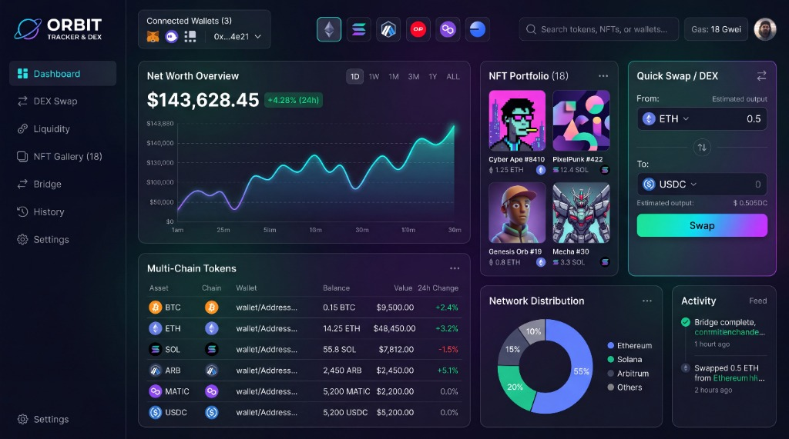

# 🌌 ORBIT // SWOOZ Tracker & Multi-Chain DEX (`v6.0`)

  

  <a href="https://domswooz.github.io/swooz-dex/"><strong>🚀 OPEN LIVE ORBIT DASHBOARD: https://domswooz.github.io/swooz-dex/</strong></a>

---

## ⚡ Quick Links

| Destination | Direct Link |
| :--- | :--- |
| **🌐 Live 24/7 Orbit DEX App (GitHub Pages)** | **[https://domswooz.github.io/swooz-dex/](https://domswooz.github.io/swooz-dex/)** |
| **📦 GitHub Repository** | **[https://github.com/DOMSWOOZ/swooz-dex](https://github.com/DOMSWOOZ/swooz-dex)** |
| **🏠 Local LAN DEX Server (`dex_server.py`)** | `http://localhost:8088` |

---

## 🌌 New in `v6.0`: Orbit Tracker & Multi-Chain DEX Bento Workspace

Built 1:1 from the Flow UI architecture for **`Encrypted Vault`** (`SHA-256 PIN Lock`), **`BobaTeaisGood4Me`** (`SHA-256 PIN Lock`), and multi-chain traders across **Samsung Galaxy Z Fold 8**, **Galaxy S26 Ultra**, and desktop workstations:

1. **🧭 Left Sidebar Navigation (`ORBIT TRACKER & DEX`)**:
   - **7 Dedicated Workspaces**:
     - **`Dashboard`**: Full 6-card Bento Workspace (`Net Worth Overview`, `Multi-Chain Tokens`, `NFT Portfolio (18)`, `Quick Swap / DEX`, `Network Distribution`, and `Activity Feed`).
     - **`DEX Swap`**: Expands the **9-Leg Dual-Exchange Straddle Control & Live Kraken/Coinbase OHLC Candlestick Deck** (`ETH/USD`, `SOL/USD`, `BTC/USD`, `LINK/USD`).
     - **`Liquidity`**: Opens the **Bid Allocation & Shared WETH Ladder Calculator** + **BobaTeaisGood4Me (`#1716`) Straddle Simulator**.
     - **`NFT Gallery (18)`**: Launches the **Live Walking NFT Stage**, **4-Up Walking Squad Comparison**, **Universal On-Chain Token Inspector (`#1–#20,000`)**, and **Universal Wallet NFT Scanner**.
     - **`Bridge`**: Cross-Exchange Kraken ⇄ Coinbase & L1/L2 Collection Orderbooks (`Invisible Friends`, `CloneX`, `a KID called BEAST`, `Mini Supers`, `"The Walk"`).
     - **`History`**: Live Target Sniper Watchlist & Verified On-Chain Sweep Feed.
     - **`Settings`**: Encrypted **4-Digit Operator Vault PIN (`1506` / `1716`)** & Multi-Wallet Account Manager.

2. **🔗 Top Telemetry Bar (`Connected Wallets`, 6-Chain Filter, Global Search & Live Gas)**:
   - **`Connected Wallets (3)` Switcher**: Switch between **`Primary Vault (Encrypted) (Encrypted Vault)`**, **`Kraken + Coinbase (9 Legs)`**, **`Partner Vault (Encrypted) (Boba #1716)`**, and **`Cold Vault (Encrypted) (133 Mini Supers #2 Whale)`**, plus a 1-tap **`[Showcase ⇄ Live]`** toggle to flip between the `$143,628.45` Flow benchmark view and live exchange + on-chain balances.
   - **6 Multi-Chain Filter Buttons**: One-tap filtering across **Ethereum (`ETH`)**, **Solana (`SOL`)**, **Arbitrum (`ARB`)**, **Optimism (`OP`)**, **Polygon (`MATIC`)**, and **Base (`BASE`)**.
   - **Global Search & On-Chain Resolver (`Search tokens, NFTs, or wallets...`)**: Filter the token table in real time, or paste any `0x...` wallet address or Token ID (`1506`, `2313`, `9143`, `6915`) and press `Enter` to inspect it on Ethereum Mainnet.
   - **Live Mainnet Gas Pill (`Gas: 18 Gwei`)**: Polls Ethereum Mainnet JSON-RPC (`eth_gasPrice`) every 15 seconds.

3. **📈 `Net Worth Overview` & Glowing Cyan-Purple Spline Chart**:
   - High-DPI HTML5 Canvas rendering a smooth Catmull-Rom / Bezier spline with glowing purple-to-cyan stroke (`#a855f7` → `#3b82f6` → `#00f5d4`) and interactive timeframe selectors (**`1D`**, **`1W`**, **`1M`**, **`3M`**, **`1Y`**, **`ALL`**).

4. **🪙 `Multi-Chain Tokens` Table**:
   - Tracks **`BTC`**, **`ETH`**, **`SOL`**, **`ARB`**, **`MATIC`**, and **`USDC`** across connected wallets and active straddle legs.
   - Clicking any token row automatically loads that asset into **`Quick Swap / DEX`** and switches the live OHLC chart pair.

5. **🖼️ `NFT Portfolio (18)` — Full-Color Backgroundless Showcase**:
   - Showcases your flagship NFTs in **100% full original vibrant color with transparent backgrounds (`nft-media/nobg/`)** over neon gradient cards:
     - **Invisible Friends `#1506`** (`0.21 ETH` • Rank `#1,621 / 5,000` • Live Walking GIF)
     - **BEAST `#2313`** (`0.06 ETH` • `a KID called BEAST` 3D Full-Body Render)
     - **CloneX `#9143`** (`0.15 ETH` • `RTFKT x Takashi Murakami`)
     - **Mini Supers `#6915`** (`133 Held` • `#2 Whale Worldwide`)
   - Tap any NFT card to launch the **Live Walking NFT Stage & 13-Trait Inspector**.

6. **⚡ `Quick Swap / DEX`, `Network Distribution` Donut & `Activity` Feed**:
   - **`Quick Swap / DEX`**: Neon cyan-to-purple gradient border card with live Kraken spot conversion across `ETH`, `USDC`, `BTC`, `SOL`, `LINK`, and `ARB`, 1-tap `⇅` pair flip, and instant execution logging to the live **`Activity` Feed**.
   - **`Network Distribution`**: Interactive SVG Donut Chart (`55% Ethereum`, `20% Solana`, `15% Arbitrum`, `10% Others`) — click any ring slice or legend item to filter tokens by network.
   - **`Activity` Feed**: Real-time log of Kraken Pro & Coinbase Advanced straddle leg flips, DEX swaps, and on-chain target verification.

---

## 🤖 9-Leg Bidirectional Dual-Exchange Straddle Daemon (`auto_flip_eth.py`)

Runs 24/7 across **Kraken Pro (3 Legs)** and **Coinbase Advanced Trade (6 Legs)** with automatic post-only limit flipping and twice-daily Discord webhook reporting (`live_tracker.py`):

- **Kraken Pro (`$908.37 ZUSD` + `3.2353 DOGE` Spin Bonus)**:
  - **Leg 1 (`OB3VUY-7XHEE-EISY6C`)**: `BUY 0.32675219 ETHUSD @ $2,365.00` *(Auto-flipped from `$2,434.30` sell fill — locks in `+$16.44` / `+0.00675 ETH` gain)*
  - **Leg 2 (`O2M55I-TTRGZ-JHPZLG`)**: `BUY 0.05085957 ETHUSD @ $2,350.00`
  - **Leg 3 (`OXHR5G-7XDXV-JDJ77G`)**: `BUY 0.13324064 SOLUSD @ $93.50`
- **Coinbase Advanced Trade (`$195.41 USDC` + `0.2849 SOL` + `0.00088 BTC` + `2.376 LINK`)**:
  - **Leg 4 (`1b4768d6`)**: `BUY 0.047195 ETH-USDC @ $2,360.00` *(Auto-flipped from `$2,435.00` sell fill)*
  - **Leg 5 (`af8d6809`)**: `SELL 0.28494619 SOL-USDC @ $97.80`
  - **Leg 6 (`245c48b9`)**: `SELL 0.0008762 BTC-USDC @ $81,800.00`
  - **Leg 7 (`21abdc51`)**: `SELL 2.37 LINK-USDC @ $11.85`
  - **Leg 8 (`6f967d19`)**: `BUY 0.02328 ETH-USDC @ $2,350.00`
  - **Leg 9 (`76e7ed73`)**: `BUY 0.3025 SOL-USDC @ $93.40`
